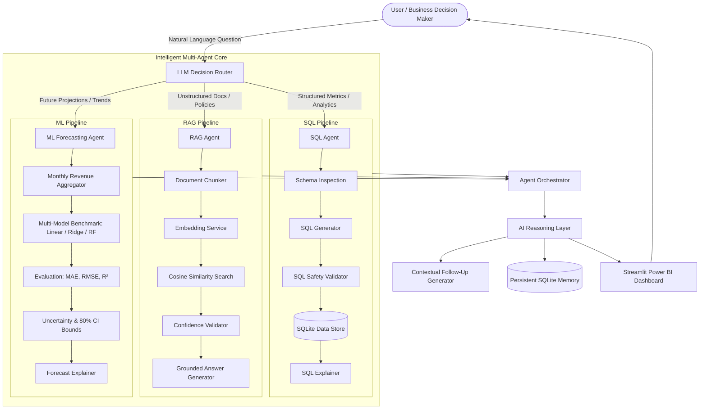

# InsightAI – AI-Powered Business Decision Intelligence Platform

InsightAI is an enterprise-grade Decision Intelligence Platform designed to empower executives, commercial managers, and business analysts with instant, data-backed insights. Combining SQL analytics, multi-model machine learning forecasting, document retrieval-augmented generation (RAG), and generative AI reasoning, InsightAI bridges the gap between raw data warehouses and business decisions.

---

## 🏛️ System Architecture



---

## 🤖 The AI Agents

### 1. SQL Agent
* **Role:** Translates natural language questions about customers, orders, products, categories, and regional performance into SQLite SQL queries.
* **Safety & Integrity:** Enforces read-only operations (allows only `SELECT` and `WITH`). Automatically rejects destructive operations (`DROP`, `DELETE`, `UPDATE`, `INSERT`, etc.) and multi-statement injection attempts.
* **Automatic Recovery:** If a generated query encounters a database execution error, the agent self-heals by invoking a recovery prompt with the exact error message and schema to regenerate and validate a corrected query.
* **Business Explanation:** Translates raw database rows into concise, natural-language executive explanations.

### 2. RAG Agent (Retrieval-Augmented Generation)
* **Role:** Answers questions regarding unstructured company policies, employee guidelines, and business documents.
* **Traceability:** Extracts paragraphs, chunks text, and generates semantic vector embeddings to retrieve relevant text passages.
* **Strict Evidence Grounding:** Only answers when cosine similarity surpasses the confidence threshold. If documents do not contain sufficient evidence, the agent declines to answer rather than hallucinating facts.
* **Citations:** Transparently cites the source document and displays retrieved text snippets with similarity scores.

### 3. ML Agent (Machine Learning & Predictive Analytics)
* **Role:** Projects monthly revenue across configurable horizons (1, 3, or 6 months).
* **Multi-Model Benchmarking:** Concurrently trains and compares multiple algorithms:
  * **Linear Regression** (Baseline trend)
  * **Ridge Regression** (L2-regularized linear trend)
  * **Random Forest Regressor** (Non-linear ensemble learning)
* **Validation & Metrics:** Evaluates candidates using **Mean Absolute Error (MAE)**, **Root Mean Squared Error (RMSE)**, and **Coefficient of Determination ($R^2$)**, automatically deploying the lowest-error model.
* **Uncertainty Quantification:** Generates 80% confidence interval bands to communicate projections as probabilistic estimates rather than guaranteed facts.

### 4. Decision Router & AI Reasoning Layer
* **Context-Aware Routing:** Classifies incoming questions into the optimal agent workflow without prompt pollution from previous chat history.
* **Synthesized Intelligence:** Generates confidence scores, routing rationales, and 2-3 logical follow-up questions to facilitate continuous exploration.

---

## 📊 Streamlit Dashboard Features (Power BI Aesthetic)

The application provides an enterprise-ready dashboard structured into 8 functional pages:

| # | Page | Key Capabilities |
|---|------|------------------|
| 1 | **Overview** | Executive KPI cards, commercial health badge, AI executive summary briefing, key business facts, and business highlights. |
| 2 | **Business Analytics** | Multi-dimensional filters (Category, City, Date range), revenue trajectories, category breakdowns, city rankings, top products table, and top customer analysis. |
| 3 | **Ask InsightAI** | Natural-language query interface, real-time agent badge attribution, confidence gauges, SQL/data table expanders, ML forecast charts, and interactive follow-up buttons. |
| 4 | **AI Executive Summary** | Commercial health diagnostic, growth drivers vs. operational risks, and strategic recommendations. |
| 5 | **Revenue Forecasting** | Multi-horizon projection selector (1, 3, 6 months), historical actuals vs. forecast with shaded 80% CI envelope, evaluation metric cards (MAE, RMSE, $R^2$), and candidate model comparison table. |
| 6 | **Document Intelligence** | Direct knowledge base query interface, document file manager, upload widget (`.txt`, `.md`, `.pdf`), and passage similarity inspector. |
| 7 | **Conversation History** | Persistent SQLite chat repository, keyword search filter, transcript card inspector, and CSV export. |
| 8 | **Settings / About** | LLM provider status, connection verification, architecture diagrams, and system metadata. |

---

## 🛠️ Tech Stack

* **Language:** Python 3.12+
* **Dashboard / UI:** Streamlit, Custom CSS (Power BI Design System)
* **Visualizations:** Plotly Express & Plotly Graph Objects
* **Database:** SQLite 3 with transactional foreign keys and check constraints
* **Data Processing:** Pandas, NumPy
* **Machine Learning:** Scikit-Learn (LinearRegression, Ridge, RandomForestRegressor, Train-Test Split, Error Metrics)
* **Embeddings & Vector Search:** Sentence-Transformers (`all-MiniLM-L6-v2`) / Scikit-Learn Vectorizer Hybrid with In-Memory Caching
* **LLM Integration:** Flexible multi-provider interface supporting OpenRouter, Google Gemini, OpenAI, and a deterministic offline heuristic fallback
* **Testing:** Pytest & standalone verification scripts

---

## 📁 Folder Structure

```
InsightAI/
├── dashboard/
│   └── app.py                     # Main Streamlit web application
├── data/
│   ├── customers.csv              # Customer records (500 entries)
│   ├── orders.csv                 # Order transactions (5000 entries)
│   ├── products.csv               # Product catalog (50 entries)
│   └── documents/
│       └── company_policy.txt     # Internal policy documentation
├── database/
│   ├── insightai.db               # SQLite database
│   └── schema.sql                 # DDL schema definition
├── docs/
│   ├── business_requirements.md   # Product specification
│   └── database_design.md         # Relational data model
├── src/
│   ├── config.py                  # Project paths and global defaults
│   ├── ai/
│   │   ├── decision_router.py     # Context-aware agent classifier
│   │   ├── agent_orchestrator.py  # Multi-agent coordinator
│   │   ├── reasoning_layer.py     # Response synthesizer & follow-up generator
│   │   ├── ai_service.py          # Executive briefing & business diagnostics
│   │   ├── business_context.py    # Enterprise context builder
│   │   ├── executive_summary.py   # AI memo generator
│   │   ├── query_engine.py        # Conversational query API
│   │   ├── sql_agent.py           # SQL generation, execution & recovery
│   │   ├── sql_schema.py          # Database schema inspector
│   │   ├── sql_generator.py       # NL-to-SQL converter
│   │   ├── sql_validator.py       # Read-only query validator
│   │   ├── sql_executor.py        # Safe SQL execution wrapper
│   │   ├── sql_explainer.py       # SQL result summarizer
│   │   ├── ml/
│   │   │   ├── ml_agent.py            # Forecasting agent orchestrator
│   │   │   ├── ml_data_service.py     # Revenue aggregation & preparation
│   │   │   ├── forecasting_service.py # Multi-model trainer & evaluation engine
│   │   │   └── forecast_explainer.py  # Forecast narrative generator
│   │   └── rag/
│   │       ├── rag_agent.py           # Retrieval-augmented generation coordinator
│   │       ├── document_loader.py     # File reader (.txt, .md, .pdf)
│   │       ├── document_chunker.py    # Paragraph & sentence chunker
│   │       ├── embedding_service.py   # Vectorizer with caching & dual-engine
│   │       ├── retrieval_service.py   # Cosine similarity ranker
│   │       ├── retrieval_confidence.py# Confidence threshold validator
│   │       └── answer_generator.py    # Grounded answer synthesizer
│   ├── analytics/
│   │   ├── analytics_service.py   # Core analytics functions & metric aggregators
│   │   └── analyze_data.py        # Command-line analytics runner
│   ├── database/
│   │   ├── conversation_service.py# SQLite conversation persistence
│   │   └── load_data.py           # CSV-to-SQLite ETL loader
│   ├── data_generation/
│   │   └── generate_data.py       # Synthetic business data generator
│   ├── llm/
│   │   ├── llm_service.py         # Multi-provider client with offline fallback
│   │   └── prompts.py             # System prompt library
│   └── ui/
│       ├── kpi_cards.py           # KPI metric cards
│       ├── ai_summary_card.py     # AI briefing memo card
│       ├── key_business_facts.py  # Essential business facts card
│       ├── charts.py              # Sales & market Plotly visualizations
│       ├── forecast_chart.py      # Historical vs. forecast chart with CI
│       └── ask_insight_ai.py      # Interactive multi-agent chat interface
├── tests/                         # Pytest unit & integration test suite
│   ├── conftest.py                # Fixtures and test setup
│   ├── test_analytics.py          # Analytics tests
│   ├── test_conversation_service.py # Persistence tests
│   ├── test_ml_agent.py           # Forecasting & model comparison tests
│   ├── test_rag_agent.py          # Document loader & retrieval tests
│   ├── test_router_and_orchestrator.py # Routing & reasoning tests
│   └── test_sql_agent.py          # SQL safety & agent tests
├── requirements.txt               # Pinned project dependencies
├── .env.example                   # Environment variable template
└── check_key.py                   # Safe credential status verification script
```

---

## 🚀 Installation & Setup

### 1. Clone & Set Up Python Environment
Ensure Python 3.12 or newer is installed.

```bash
git clone https://github.com/your-username/insightai.git
cd insightai
python -m venv .venv

# Activate Virtual Environment:
# On Windows (PowerShell):
.venv\Scripts\Activate.ps1
# On macOS / Linux:
source .venv/bin/activate
```

### 2. Install Dependencies
```bash
pip install -r requirements.txt
```

### 3. Configure Environment Variables
Copy the template `.env.example` to `.env`:
```bash
cp .env.example .env
```
Open `.env` and configure your API key for OpenRouter, Google Gemini, or OpenAI:
```dotenv
OPENROUTER_API_KEY=your_actual_key_here
LLM_MODEL=openai/gpt-4o-mini
```
> **Note:** InsightAI includes an intelligent deterministic fallback engine. If no API key is configured, the application operates smoothly in demo/offline mode without crashing.

### 4. Verify Credentials Safely
Run the credential checker to ensure environment variables are recognized without leaking secrets:
```bash
python check_key.py
```

### 5. Initialize Database (ETL Pipeline)
Populate the SQLite database from the raw CSV datasets:
```bash
python -m src.database.load_data
```

---

## 💻 Running the Application

Launch the Streamlit web dashboard:
```bash
streamlit run dashboard/app.py
```
Open your browser at `http://localhost:8501`. Use the sidebar to navigate across the 8 pages.

---

## 🧪 Testing Instructions

InsightAI maintains two testing layers: comprehensive Pytest unit tests and legacy end-to-end verification scripts.

### Run the Pytest Suite:
```bash
pytest tests/ -v
```
*(All 21 unit tests cover analytics, SQL validation, RAG retrieval, ML forecasting, agent routing, and SQLite conversation persistence).*

### Run the Verification Scripts:
```bash
python test_agent_orchestrator.py
python test_sql_agent.py
python test_ml_agent.py
python test_rag_agent.py
```

---

## 🔒 Security Best Practices

* **No Leaked Secrets:** Environment variables and credentials are never printed to console or written to logs.
* **Safe SQL Execution:** Only `SELECT` and `WITH` statements are allowed. Destructive operations (`DROP`, `DELETE`, `UPDATE`, `INSERT`, `ATTACH`, `PRAGMA`) are strictly blocked before reaching SQLite.
* **Source Control Integrity:** `.env` is explicitly included in `.gitignore`.

---

## ⚠️ Limitations & Future Roadmap

* **Forecasting Horizon:** The current forecasting engine relies on 12 months of aggregated historical data. For multi-year forecasting with complex seasonal periodicity, ingesting 36+ months of historical data is recommended.
* **Document Formats:** Document Intelligence currently processes `.txt`, `.md`, and standard `.pdf` files. Complex scanned images and OCR tables will be enhanced in future releases.
* **Database Scaling:** The platform currently uses SQLite for local deployments. A direct PostgreSQL adapter can be enabled for enterprise high-concurrency production deployments.
